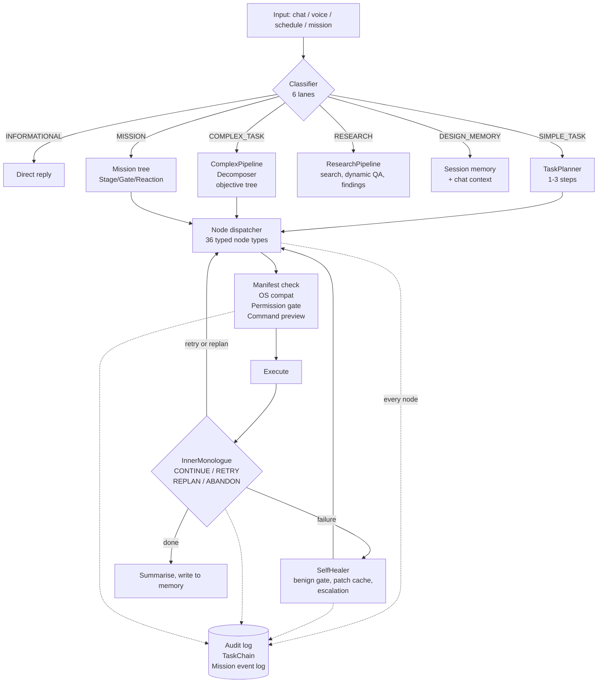

# ALTRON — Explainable Agent Infrastructure

**Artificial Learning Tactical Red-team Operator Network**

A local-first autonomous agent platform for authorized security testing, built on one
architectural bet: **an agent you cannot audit is an agent you cannot deploy.**

ALTRON does not wrap a large language model in a loop and hope for the best. It
decomposes work into small, typed, individually-logged nodes, bounds the model's
authority at every decision point to a closed set of choices, and records the reason
for each choice as structured data rather than prose. The result is an agent whose
behaviour can be reconstructed after the fact, step by step, from append-only logs.

> **This repository is documentation only.** It contains no source code. ALTRON is
> proprietary software; the implementation lives in a private repository. What follows
> is an architecture and engineering write-up intended for technical readers
> evaluating the design and the work behind it. Short illustrative excerpts are
> included where they make a design decision concrete.

---

## Contents

| Document | What it covers |
|---|---|
| **[docs/EXPLAINABILITY.md](docs/EXPLAINABILITY.md)** | The core thesis — the five logging layers, and how model authority is bounded at each decision point |
| **[docs/ARCHITECTURE.md](docs/ARCHITECTURE.md)** | Subsystem map, execution lanes, the node graph, memory and LLM routing |
| **[docs/MISSION_TREE.md](docs/MISSION_TREE.md)** | The reactive scenario engine — Stages, Gates, Triggers, Reactions, Decisions |
| **[docs/ENGINEERING_NOTES.md](docs/ENGINEERING_NOTES.md)** | Design decisions, tradeoffs, and bugs found the hard way |

---

## The problem

Autonomous agents in security work fail an operational test that has nothing to do
with capability. Suppose an agent runs for six hours against an authorized target
range and, somewhere in hour four, disables a service. Three questions follow
immediately:

1. What exactly did it run, in what order, against what?
2. At the moment it chose that action, what alternatives did it have?
3. Why that one?

A monolithic agent — one model, one context window, one long reasoning trace —
answers the first question badly and the second and third not at all. Its chain of
thought is prose generated alongside the actions, not a record of the decision
procedure. It cannot tell you what the model *could* have picked, because nothing in
the system ever enumerated the options.

ALTRON is built around answering all three.

---

## The approach: small nodes that log

Work is expressed as a graph of **36 typed node types**. Each node is small enough to
describe in one line, declares its own inputs and outputs, and is executed by a
dispatcher that logs its entry and exit independently of the model.

```
core.shell              run an exact shell command
core.simple_task        natural-language step the model turns into a command
core.local_compute      compute a value locally, bind it to a parameter
core.finding            record a typed finding
core.credential         record a captured credential
core.persistence        register a planted mechanism
core.verify_persistence check whether it is still alive
core.mitre_lookup       query the local ATT&CK cache
core.tunnel_open/exec/close   SOCKS5 tunnel lifecycle
org.parallel            run children concurrently
org.conditional         branch on exit code or model judgment
org.for_each            iterate a list
org.checkpoint          pause for operator approval
memory.extract          extract facts into the knowledge graph
custom.<id>             recurse into another template
```

Because the unit of work is a node rather than a turn, the audit trail is structural.
Every node execution emits a start and a done event carrying its id, type, depth,
parent, resolved action, and terminal status — emitted by the dispatcher, before and
after the node body runs, whether or not a model was involved:

```python
_emit_nd = lambda status: self._ws_emit({
    'type': 'task_node_start', 'data': {
        'id': nid, 'title': title, 'node_type': ntype, 'depth': depth,
        'parent_id': node.get('parent_id'),
        'action': node.get('action', ''),
        'flexible': _flex,
        'context_from': node.get('context_from') or [],
    }})
```

A skipped node logs *why* it was skipped — resumed from a checkpoint, or overridden by
the planner — rather than silently vanishing from the trace. This matters more than it
sounds: a node that disappears from a log is indistinguishable from a node that never
existed, and that gap is exactly where post-incident reconstruction breaks down.

---

## The approach: bounded model authority

Logging what happened is half of explainability. The other half is making the decision
space small enough that "why" has a finite answer.

Every point where a model influences control flow in ALTRON is constrained to a
closed, enumerated set, and the choice is recorded:

| Decision point | Model's choice is bounded to | Validated how |
|---|---|---|
| Intent routing | 1 of 6 lanes | Checked against an explicit `_VALID_LANES` set; invalid output falls back deterministically |
| Post-failure reasoning | `CONTINUE` / `RETRY` / `REPLAN` / `ABANDON` | Fixed output grammar; stagnation guard forces `ABANDON` on repeats |
| Scenario branching | 1 of N branch ids wired in the editor | Set derived from graph topology at evaluation time; must return a `branch_id` verbatim or `none` |
| Narrative generation | Nothing — narrates around content it cannot author | Operator-authored payload passed as immutable, opaque context |
| Command classification | 1 snake_case label, or `unknown` | Rule-based regex library runs first; model is fallback only, and only labels data |
| Failure healing | Not consulted until a deterministic benign-failure gate passes | Pattern table of known non-failures |

The scenario-branching case is the strictest, and the design note on it is the one I
would point a reviewer at first:

> The closed set of choices is **not** stored in the node. It is derived at evaluation
> time from which branches are actually wired to depend on this Decision node — the
> same connections an operator drags in the editor — so the model's valid-answer set
> can never drift out of sync with the graph. The model sees the operator's written
> description of each option, never the option's own payload. It structurally cannot
> select or invent anything outside the wired set.

That property is architectural, not prompted. Prompt-level instructions to "only pick
from this list" are advisory; deriving the list from the graph and rejecting anything
outside it is enforceable.

Full treatment: **[docs/EXPLAINABILITY.md](docs/EXPLAINABILITY.md)**.

---

## System overview



---

## Scale

| | |
|---|---|
| Python | ~32,000 lines across 97 modules |
| Front end | ~22,000 lines, vanilla JS/CSS — no framework |
| Subsystem packages | 23 (`agent`, `missions`, `templates`, `redteam`, `self_heal`, `llm`, `memory`, `bastion`, `permissions`, `vault`, …) |
| Node types | 36 |
| Plan templates | 59 JSON graphs — 27 in the shipped red-team library across 13 categories, the remainder lab and scenario content |
| Detected tool integrations | 160+, discovered at runtime and capability-checked |
| LLM backends | Ollama, Anthropic, OpenAI-compatible, llama.cpp, LM Studio, vLLM, Jan |
| Test modules | 7 (pipeline, templates, LLM routing, scope, research, cron missions) |

---

## Capability tour

**Local-first inference with hardware-aware model selection.** ALTRON profiles the host
at install time and selects a model tier from VRAM and RAM floors, including code and
reasoning specialists routed by task type:

```python
TIERS = [
    {
        "tier": 4, "label": "workstation / multi-GPU",
        "min_vram_gb": 48, "min_ram_gb": 64,
        "primary": {"name": "llama3.3:70b-q4_K_M", "context_window": 128000, ...},
        "specialists": [
            {"name": "qwen2.5-coder:32b-q4_K_M", "role": "code",
             "trigger_task_types": ["code_generation", "script_debug", "self_heal_patch"]},
            {"name": "deepseek-r1:70b-q4_K_M", "role": "reasoning",
             "trigger_task_types": ["complex_planning", "multi_step_reasoning"]},
        ],
    },
    # tiers 3..0 -> high-end GPU, mid-range, entry, CPU-only
]
```

Cloud APIs are an option, not a dependency. The system runs fully offline on a laptop
at the bottom tier, and escalates to a frontier model only where configured to.

**Self-healing execution.** Failures route through a five-step chain: contrast actual
against intended outcome, classify root cause, check a content-addressed patch cache,
attempt a local fix, then escalate. Successful fixes are stored against a failure hash
that includes a command signature, so a cached patch cannot misfire in an unrelated
context — and a stored patch that fails on reapplication is purged rather than left to
keep misfiring.

**Reactive scenario engine.** Missions are authored as graphs of Stages, Gates,
Triggers, Reactions, and Decisions, driven by six condition types including live
finding detection, persistence-artifact state, and semantic classification of trainee
commands. This is what turns ALTRON from a task runner into a training adversary that
responds to what a defender actually does. See
**[docs/MISSION_TREE.md](docs/MISSION_TREE.md)**.

**Operational memory.** A JSON-backed key/value and failure/patch store sits alongside
a Graphiti knowledge graph (FalkorDB + embeddings) for semantic recall across sessions.
The graph is optional; the system degrades gracefully without it.

**Red-team state tracking.** Typed stores for live sessions, captured credentials,
planted persistence with liveness tracking, network adjacency for pivot planning, SSH
tunnels, a locally cached MITRE ATT&CK Enterprise corpus, and a reference library.

**Scope enforcement.** Authorized targets and forbidden patterns are declared per
engagement and checked before execution, independently of anything the model proposes.

---

## Authorization and intent

ALTRON is built for authorized security testing — penetration tests under written
scope, CCDC and similar competition practice, and defensive training exercises. Scope
enforcement, permission gating, operator checkpoints before destructive steps, and the
audit log all exist because the deployment model assumes a human is accountable for
what the system does.

It should never be pointed at a system you do not own or lack explicit written
permission to test.

---

## About this project

Built solo, over roughly seven months and 136 commits, alongside
[LabGen](https://github.com/JohnBullDog/labgen-docs) — the Docker lab generator that
provides ALTRON's practice targets. The two are designed to pair: LabGen produces a
segmented network with Active Directory and pivot paths, and ALTRON runs missions
against it.

The explainability architecture was not the original design. The first version was a
conventional plan-and-execute loop, and it was genuinely difficult to answer basic
questions about what it had done and why. Rebuilding around typed nodes and bounded
model authority was the single largest structural change the project went through, and
it is the part of the work I would most want a reviewer to look at.

**Contact:** [github.com/JohnBullDog](https://github.com/JohnBullDog)
