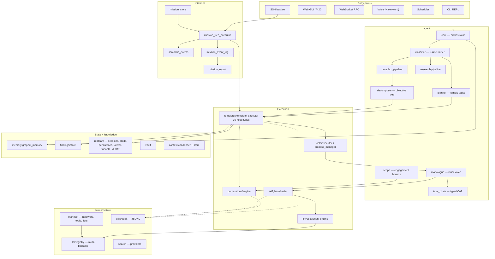
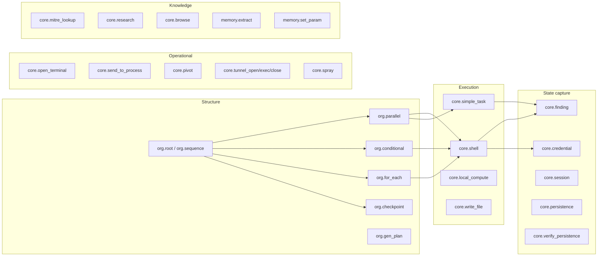

# Architecture

Subsystem map, execution lanes, the node graph, and the supporting infrastructure —
permissions, memory, LLM routing, and the escalation ladder.

For the explainability thesis that motivates most of these choices, see
**[EXPLAINABILITY.md](EXPLAINABILITY.md)**.

---

## Subsystem map

23 packages, ~32,000 lines of Python across 97 modules.



---

## Execution lanes

The classifier routes every input into one of six lanes. Each lane has a different
cost profile and a different approval model, which is the point — a factual question
should not pay for plan generation, and a multi-phase operation should not execute
without a confirmed plan.

| Lane | Pipeline | Approval | Produces |
|---|---|---|---|
| `INFORMATIONAL` | Direct model reply with memory context | None | An answer |
| `SIMPLE_TASK` | `TaskPlanner` — 1 to 3 steps | Confirm plan once | Executed steps |
| `COMPLEX_TASK` | `ComplexPipeline` → `TaskDecomposer` → objective tree | Confirm plan, upfront permissions | Executed graph |
| `RESEARCH` | `ResearchPipeline` — search, dynamic Q&A, findings report | None | A findings report |
| `DESIGN_MEMORY` | Session memory + chat context, tools allowed | Per-tool | Stateful conversation |
| `MISSION` | `MissionTreeExecutor` — Stage/Gate/Reaction graph | Operator-authored | A running scenario |

Routing is covered in [EXPLAINABILITY.md §7](EXPLAINABILITY.md#intent-routing-validated-against-a-closed-set) —
it turns on a single deliverable question rather than keyword matching, and the output
is validated against a closed lane set.

### The approval model

For `SIMPLE_TASK` and `COMPLEX_TASK` the sequence is: show the plan, take one
confirmation, request every permission the plan will need **upfront**, then execute.

Requesting permissions as a batch before execution rather than one at a time is a
deliberate tradeoff. Mid-execution prompts train operators to approve reflexively, and
a half-executed plan that stalls on a denied permission leaves the target in an
undefined state. Asking once, with the full list, means the operator sees the real
blast radius before anything runs. Session grants live in memory for the task's
duration and are revoked on completion.

---

## The node graph

The execution substrate. 36 node types; a template is a parameterised JSON graph of
them, and `custom.<id>` recurses into another template so graphs compose.



### Parameter flow

Templates are parameterised with `{{placeholder}}` syntax. A node can declare
`param_out` to bind its result to a name that downstream nodes substitute. This is
explicit dataflow rather than a shared context window, which is what makes a value in
a logged command traceable to the node that produced it.

A two-node illustration of local compute feeding a remote command:

```json
{"type": "core.local_compute",
 "command": "openssl passwd -6 '{{password}}'",
 "param_out": "shadow_hash"}

{"type": "core.shell",
 "action": "sed -i 's/^root:[^:]*:/root:{{shadow_hash}}:/' /etc/shadow",
 "run_remote": "root@{{target}}"}
```

The hash is computed locally and substituted into the remote command, so the plaintext
never crosses the wire and the executed command is logged with the substituted value
present.

### Node-level controls

Beyond type and action, a node can declare:

| Field | Effect |
|---|---|
| `use_memory` | Query the knowledge graph for relevant prior context before running |
| `context_from` | Declare which upstream nodes feed this one (logged with the event) |
| `flexible` | Allow the planner to rewrite or skip this node mid-run |
| `run_remote` | Execute over a managed SSH session rather than locally |
| `param_out` | Bind the result to a parameter name |

### Execution gates

Before a node's command runs it passes through a fixed sequence, independent of the
model:

1. **Budget check** — token and step ceilings for the run
2. **Checkpoint check** — skip if already completed in a prior run (logged as skipped)
3. **Flexible override** — planner skip or action rewrite (logged, writes a `REPLAN` thought)
4. **Manifest check** — is the tool present and capability-matched on this host?
5. **OS compatibility** — does the tool run on this platform?
6. **Scope check** — is the target authorized, and does the command match a forbidden pattern?
7. **Permission gate** — three-tier, with password required for pentest-class tools
8. **Command preview** — exact resolved string shown before execution

---

## Permissions

Three tiers, with session-scoped grants:

| Tier | Behaviour |
|---|---|
| `default_allow` | No prompt — filesystem read/write/watch, media and data processing, local code execution, memory read/write, voice wake word |
| `must_ask` | Prompt once per session; **pentest-class tools additionally require the vault password** |
| `never_allow` | Always blocked, regardless of approval |

Grants are held in memory for the task's duration and revoked on completion, so
approval does not silently persist into the next task. Every grant and every denial is
written to the audit log.

The password requirement on pentest tooling is the meaningful line here. A model that
has been prompt-injected, or has simply reasoned its way to a bad conclusion, can
request a permission. It cannot supply the vault password.

---

## Self-heal and the escalation ladder

When a node fails, recovery proceeds through two cooperating systems.

**`SelfHealer`** owns diagnosis and the patch cache:

```
Gate 1  Benign-failure table — grep exit 1, nmap exit 2, curl 22 ... skip entirely
Gate 2  Require a >=10 char error signal
Step 1  Contrast actual vs intended outcome
Step 2  Classify root cause (missing_dep / permission / network / logic / auth)
        - reads stderr first, stdout only when stderr is empty
        - requires a >=15 char matched signal to avoid keyword false positives
Step 3  Hash the failure (tool + cause + target type + 48-char command signature)
        - look up patch cache; apply if hit
        - if a cached patch fails on reapplication, purge it
Step 4  Local fix attempt, or hand off to the escalation engine
Step 5  Store a successful fix as a permanent patch against the failure hash
```

Including a command signature in the hash is what prevents a patch learned in one
context from firing in an unrelated one — a fix for `nmap` failing on a missing
dependency should not be applied to `nmap` failing on an unreachable host.

**`EscalationEngine`** owns the cost ladder. Its explicit goal is token minimisation,
climbing only as far as needed:

```
Stage 0  Local retries via LLMRegistry — any registered backend, any model
Stage 1  Progress check — if stagnant, climb
Stage 2  Context compression — extract only the relevant signals
Stage 3  Small cloud model writes step-by-step instructions for the local model
Stage 4  Local model attempts to follow those instructions (multi-turn)
Stage 5  Large cloud model full takeover, tools enabled
```

Stage 3 is the interesting rung: rather than handing the whole problem to an expensive
model, a cheap one writes instructions precise enough for a local model to execute.
Most failures resolve before stage 5, and the token cost of the ones that do not is
bounded by the compression at stage 2.

From the module's own note: *"At every stage the escalation engine records what was
tried so the self-heal loop has a complete audit trail."* The ladder is not just a cost
optimisation — each rung is a logged, attributable step.

---

## LLM routing

A pluggable backend registry with persistent registration and per-task-type routing.

Built-in backends: `OllamaBackend` (local, always present), `OpenAIBackend` (any
OpenAI-compatible endpoint — LM Studio, vLLM, Jan), `LlamaCppBackend` (llama.cpp HTTP
server), `AnthropicBackend`. Custom backends register at runtime.

Backends carry a priority; the router picks the highest-priority reachable one for the
task type. Operators manage this from the GUI or the CLI:

```
:llm                              list backends
:llm add-anthropic [key] [model]  add a Claude backend (pulls key from vault)
:llm add-ollama <url> <id> <name> add a remote Ollama instance
:llm add <url> <id> <name>        add any OpenAI-compatible backend
:llm set-primary <id>             make a backend primary (priority 0)
:llm set-model <id> <model>       change the default model
:llm test <id>                    check reachability
:llm pull <model>                 download a model via Ollama
```

### Hardware-aware model selection

At setup the manifest builder profiles the host — CPU, RAM, GPU, VRAM — detects
installed tools, and selects a model tier. Each tier declares a primary, an alternate,
and role-tagged specialists routed by task type:

| Tier | Floor | Primary | Specialists |
|---|---|---|---|
| 4 — workstation / multi-GPU | 48 GB VRAM, 64 GB RAM | `llama3.3:70b-q4_K_M` | code (`qwen2.5-coder:32b`), reasoning (`deepseek-r1:70b`) |
| 3 — high-end GPU | 16 GB VRAM | `mistral-small3:24b-q4_K_M` | code |
| 2 — mid-range GPU | 8 GB VRAM | `llama3.1:8b-q4_K_M` | — |
| 1 — entry GPU | 4 GB VRAM | `phi3.5:3.8b-q4_K_M` | — |
| 0 — CPU only | — | `phi3.5:3.8b-q4_K_M` | — |

Specialists are dispatched by `trigger_task_types` — a self-heal patch or a script
debug routes to the code specialist, complex planning to the reasoning specialist —
rather than by a single model handling everything. An optional speed benchmark
validates the selection on the actual host.

Setting a cloud backend as primary makes the whole system API-only, with no GPU
required.

---

## Context condensation

Large inputs — a scan dump, a competition report, a credential list — go through a
three-pass condenser rather than straight into a context window. The ordering is the
same determinism-first pattern used elsewhere:

```
Pass 1  Pattern pass (regex, always runs, no model)
        - split into semantic sections by header / blank lines
        - extract typed entities: IPs, CIDRs, ports, credentials,
          hostnames, key-value params, shell/command lines
        - detect document type (ccdc_report, scan_output, cred_list, log, generic)

Pass 2  Confidence check
        - score entity density (entities per 100 chars)
        - low confidence + large document -> trigger pass 3

Pass 3  Model extraction (optional, async, cached by input hash)
        - targeted prompt: IPs, CIDRs, kv_params, credentials, intent
        - JSON output merged back into the entity dict
```

A well-formed scan output never reaches a model at all — the regex pass extracts
everything with high confidence. The model is spent only on documents the
deterministic pass handles poorly, and results are cached by input hash so identical
input is never re-extracted.

---

## Memory

Two cooperating stores:

**`GraphitiMemory`** — JSON persistence for key/value state, task history, recorded
failures, and stored patches. Always available.

**Graphiti knowledge graph** — FalkorDB plus embeddings for semantic recall across
sessions, grouped by operation. Optional; the system degrades gracefully when FalkorDB
is not running, which matters because it is an extra service an operator may not want
on a laptop.

Nodes opt in to graph recall with `use_memory`, which queries by the node's action or
title and prefers the operation group over the project name for scoping.

---

## Red-team state

Typed stores rather than free-text notes, so mission logic can query them as gate
conditions:

| Store | Holds |
|---|---|
| `SessionStore` | Active shells and sessions (SSH, PTY, webshell) per operation |
| `CredentialStore` | Captured passwords, hashes, keys, tokens |
| `PersistenceRegistry` | Planted mechanisms with liveness status (active / dead / unknown) |
| `LateralGraph` | Network adjacency for pivot-chain planning |
| `TunnelManager` | SSH dynamic-forwarding tunnels, proxychains integration |
| `MITREStore` | Local ATT&CK Enterprise cache, 30-day TTL |
| `ReferenceLibrary` | Locally cached commands, flags, snippets |
| `FindingsStore` | Typed findings — host, port, service, type, detail, severity |

Being typed is what makes the mission engine's `detection` and `artifact_state` gate
conditions possible — a gate can fire on "a finding of this type appeared" or "this
persistence mechanism is now dead" only because findings and persistence entries are
structured records rather than log lines. See
**[MISSION_TREE.md](MISSION_TREE.md)**.

---

## The SSH bastion

For training scenarios, trainees connect through an inbound SSH server that ALTRON
operates as a jump box. It authenticates against a team store, relays each session on
to the real lab target using a credential pulled from the credential store, records a
byte-for-byte transcript per session, and frames complete command lines to hand to the
mission executor for gate evaluation.

This is the input path that makes reactive scenarios work: the mission engine learns
what a defender is doing because the bastion sees every command they type, attributed
to a team.

Implementation notes worth flagging, because they are the kind of constraint that
shapes a design: the upstream leg reuses the paramiko password-auth client pattern
already established in the tunnel manager, the inbound leg is a `paramiko.Transport`
server accepting one thread per connection, and it is a **single shared bastion
process per mission** that attributes commands to a team via per-team credentials —
deliberately not a general multi-tenant proxy.

That threading model is also the direct cause of the mission-event-log race described
in [EXPLAINABILITY.md §6](EXPLAINABILITY.md#the-race-condition-and-how-the-logs-own-absence-revealed-it):
bastion sessions run on real OS threads while the RPC server runs an asyncio loop on
the main thread, which is why the fix required a `threading.Lock` rather than an
`asyncio.Lock`.

---

## Interfaces

**Web GUI** on `:7420` — 13 panels: Chat, Tasks (with chain-of-thought and exec log),
Tools, LLM, Missions, Mission Tree (the scenario authoring canvas), Templates,
Schedule, Scope, Memory, Red Team, Escalation, Settings. Roughly 22,000 lines of
vanilla JS and CSS, no framework — including a graph editor and a mission editor.
First launch runs a guided tour; each panel header has a replayable section tutorial.

**CLI REPL** with built-ins for manifest rebuild, tool trust, vault operations, LLM
management, scope management, and scheduling.

**WebSocket RPC** at `ws://127.0.0.1:7420/ws` — the interface another agent or script
drives ALTRON through. The RPC reference ships alongside the packaged binaries so it is
available without the source repo.

**Voice** — wake-word input pipeline.

**Scheduler** — cron-style and file-watch triggered tasks, plus heartbeat templates
that verify persistence and re-establish dead sessions.

---

## Packaging

Built with PyInstaller into two self-contained binaries (CLI and GUI) inside a
Docker build (`ubuntu:22.04`, glibc 2.35, Python 3.11) so the artifacts run on a
predictable glibc floor rather than whatever the build host happens to have. Installers
for Linux and Windows handle the Ollama and FalkorDB dependencies.

---

## See also

- **[EXPLAINABILITY.md](EXPLAINABILITY.md)** — the logging layers and bounded model authority
- **[MISSION_TREE.md](MISSION_TREE.md)** — the reactive scenario engine
- **[ENGINEERING_NOTES.md](ENGINEERING_NOTES.md)** — decisions, tradeoffs, and bugs found live
