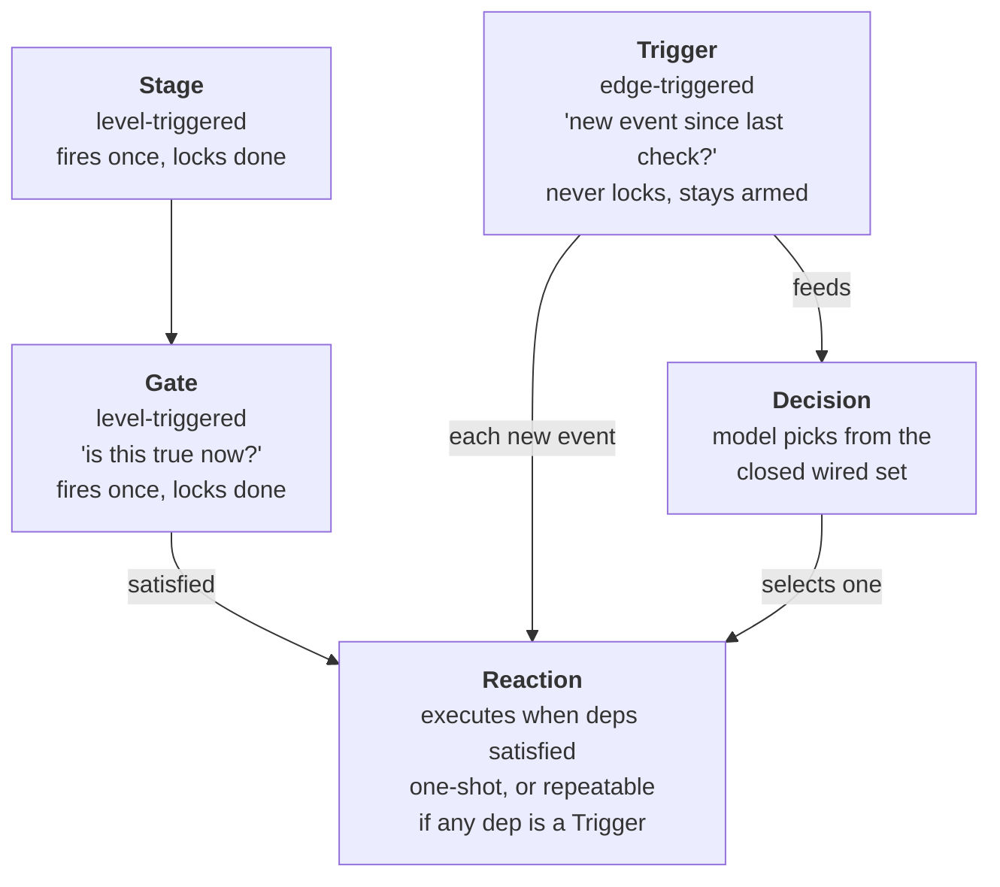

# The Mission Tree Engine

A reactive scenario engine for security training. Missions are authored as graphs of
five node kinds, driven by six condition types, and produce a deterministic after-action
report.

This is the subsystem where the explainability architecture is load-bearing rather than
merely tidy: a mission is an adversary that responds to a defender's actions, and the
question "why did the adversary do that" has to have an answer an instructor can give.

---

## What problem it solves

A static lab is a checklist. Targets sit there, a trainee works through them, and
nothing the trainee does changes what they face. Real incident response is not like
that — an adversary notices eviction and responds.

The obvious way to build a responsive adversary is to put a model in a loop with tools
and let it improvise against the defender. That produces an adversary nobody can grade,
debug, or trust: the instructor cannot predict what it will do, cannot explain what it
did, and cannot run the same scenario twice.

The mission tree is the alternative. An instructor authors the scenario as a graph. The
adversary's possible behaviours are enumerated in advance and wired explicitly. What
the engine supplies is **timing and selection** — which authored branch fires, when, in
response to which observed defender action. Model involvement is bounded to choosing
among wired options and writing prose around operator-authored content.

The scenario stays reproducible. The adversary still reacts.

---

## Five node kinds



| Kind | Trigger semantics | Locks? | Repeatable? |
|---|---|---|---|
| **Stage** | Level — condition true now | Yes, to `done` | No |
| **Gate** | Level — condition true now | Yes, to `done` | No |
| **Trigger** | Edge — a *new* satisfying event since last check | Never | Yes, stays `running` for the mission |
| **Reaction** | Runs when dependencies are satisfied | On completion | Only if a dependency is a Trigger |
| **Decision** | Model selects among wired options | Yes, unless `reevaluate` | Yes, if `reevaluate` |

### Level versus edge is the key distinction

A **Gate** asks "is this true right now?" It fires once and locks to `done` forever.
Appropriate for milestones: *the trainee has found the web shell*.

A **Trigger** asks "has a new satisfying event happened since I last looked?" It never
locks and stays armed for the rest of the mission. Appropriate for recurring behaviour:
*every time the trainee runs a checksum*.

That distinction drives repeatability, and the rule is elegantly simple:

> A Reaction becomes repeatable exactly when at least one of its `depends_on` is a
> Trigger. Reactions with only Gate/Stage dependencies keep the exact one-shot
> behaviour they've always had; that code path is untouched by any of this.

Repeatability is not a flag an author sets and can get wrong. It is a consequence of
what the Reaction is wired to. An author who wants a reaction to fire repeatedly wires
it to a Trigger, and the semantics follow from the topology — the same principle that
makes the Decision node's option set safe.

---

## Six condition types

A Gate or Trigger composes conditions with `all` or `any` logic:

```python
@dataclass
class GateCondition:
    """One input signal a Gate can check."""
    type:       str    # manual | schedule | detection | artifact_state
                       # | trainee_input | semantic_event
    match_spec: dict = field(default_factory=dict)

@dataclass
class GateSpec:
    """Boolean composition of GateConditions that must be satisfied to fire."""
    logic:      str  = "all"   # all | any
    conditions: list = field(default_factory=list)
```

| Type | Fires on | `match_spec` |
|---|---|---|
| `manual` | Instructor pushes a button | — |
| `schedule` | Wall-clock time or elapsed seconds since arming | `{"timestamp": ...}` or `{"after_seconds": 600}` |
| `detection` | A typed finding appeared in `FindingsStore` | finding type, host, port, service, severity |
| `artifact_state` | A `PersistenceRegistry` entry matches a filter | host, persist type, status |
| `trainee_input` | A trainee command line matched a regex | `{"regex": "...", "team_id": "..."}` |
| `semantic_event` | A trainee command classified as a named event | `{"event": "checksum_run", "team_id": "..."}` |

When a condition fires it records **match context** — the host, port, service, finding
type, severity, or the matched line and team id — onto the branch. Downstream reactions
substitute those values, so a reaction can name the specific host the trainee just
touched. The match context is also what makes a fired gate explainable after the fact:
the log says not just *that* it fired but *on what*.

### Why `semantic_event` exists

`trainee_input` with a regex works, and it does not scale. Every gate author writes and
re-derives the same patterns, and they drift. The semantic-event layer classifies a
command line once into a named, reusable event:

```python
DEFAULT_LIBRARY: list[dict] = [
    {"event": "checksum_run", "regex": r"\b(md5sum|sha1sum|sha256sum|shasum|cksum)\b",
     "description": "Trainee computed a file checksum/hash"},
    {"event": "persistence_check",
     "regex": r"\b(crontab\s+-l|systemctl\s+(list-unit-files|status)|schtasks\b)",
     "description": "Trainee checked for scheduled/persistent tasks"},
    {"event": "credential_dump",
     "regex": r"\b(mimikatz|secretsdump)\b|(/etc/shadow|/etc/passwd)",
     "description": "Trainee accessed or dumped credential material"},
    {"event": "log_clearing",
     "regex": r"\b(history\s+-c|rm\s+.*bash_history|wevtutil\s+cl)\b",
     "description": "Trainee attempted to clear logs/history"},
]
```

Gate authors write `{"event": "persistence_check"}` instead of a regex. Rule matching is
deterministic and runs first; a model is consulted only for unrecognised lines, only to
return one snake_case label or `unknown`, and the library is extended by editing JSON
rather than code. Unmatched lines are logged as suggestions, so the pattern library
grows from real missions and the system becomes *more* deterministic with use.

---

## Reactions: three kinds, one boundary

```python
@dataclass
class ReactionSpec:
    """What a Reaction node does when its Gate fires.

    kind == template_ref    -> run an existing Plan Template via TemplateExecutor
                               (fully deterministic).
    kind == static_inject   -> deliver literal pre-authored `content`
                               ({{param}} substitution only, no LLM).
    kind == llm_narrative   -> one narrow model call; `payload_context` is passed as
                               immutable, opaque context the model never authors or
                               judges — it only writes narrative text per
                               `narrative_prompt` around content it doesn't control.
    """
```

Two of the three kinds involve no model whatsoever. `template_ref` runs a deterministic
plan-template graph. `static_inject` delivers operator-written text with parameter
substitution.

The third, `llm_narrative`, is the only one that generates, and it is explicitly scoped
to generating *around* content it cannot author. The model gets `payload_context` as
immutable opaque input and a `narrative_prompt`, and writes prose. It never decides what
happened.

Three controls make that practical rather than merely safe:

**`include_context`** gives the prompt the same bounded, read-only reference text a
Decision node's context gathering produces — recent trainee input, recent semantic
events, current findings. This is what makes narration responsive to what just
happened, instead of generating from identical static input every firing.

**`narrative_mode`** is `freeform` or `structured`. Structured mode assembles the prompt
from `narrative_tone`, `speaker_role`, `what_happened`, and `what_next`, trading
authoring flexibility for a narrower, more predictable output shape.

**`narrative_fallback`** holds pre-approved text, typically captured from a preview
call, used if live generation times out or fails — so a slow or unavailable local model
cannot stall a mission's reaction firing indefinitely. That is a small detail with a
large consequence: a model becomes a soft dependency rather than a hard one.

### Narrating and acting, separately

`side_effect_template_id` is independent of `kind`: an optional second plan template
dispatched alongside whatever the reaction narrates, for reactions that should also
change real state.

The canonical case is "the adversary re-plants persistence". The narrative tells the
trainee something happened; the side-effect template actually re-plants it. Separating
these means the prose cannot drift from reality — the state change is a deterministic
template, and the model only describes it.

### `approved_list`: the pattern that actually proved out

`side_effect_mode` is `single` by default — one pre-set template. The alternative is
`approved_list`, and it turned out to be the most useful mechanism in the engine:

> `side_effect_template_options` holds a closed set of
> `{template_id, description, template_params}` the operator has pre-approved, and at
> fire time the model picks exactly one by ID via the same grammar-constrained
> closed-set mechanism a Decision node uses — it can never invent a template outside
> this list, same safety boundary as everywhere else an LLM touches mission content.

This gives varied, situationally-chosen *real actions* without a Decision node and
without extra graph nodes per option. The adversary genuinely does different things on
different runs, every one of them pre-approved by the instructor.

One detail is a good illustration of thinking a mechanism through rather than just
shipping it. `side_effect_include_context` defaults to `True` here, unlike
`llm_narrative`'s `include_context`, which defaults `False`:

> A closed-set pick with zero situational awareness is close to meaningless — it's
> effectively an unweighted coin flip driven only by however the model happens to read
> the static descriptions, not by what actually happened. `llm_narrative` can still
> produce reasonable flavor text with no context; this can't produce a reasoned pick
> without it.

Narration without context is merely bland. Selection without context is noise wearing
the costume of a decision — and worse, it is noise that *looks* explainable in the log.
Different mechanisms, different defaults.

As [ENGINEERING_NOTES.md](ENGINEERING_NOTES.md#the-decision-node-worked-on-paper-before-it-worked-in-practice)
records, `llm_narrative` + `approved_list` with no Decision node became the default
shape for "the model picks a varied real action" after Decision nodes proved unreliable
with small local models.

---

## Decisions: the closed set

The one place a model chooses what happens next.

```python
@dataclass
class DecisionSpec:
    """What a Decision node asks the LLM to pick between.

    The closed set of choices is NOT stored here — it's derived at evaluation
    time from which branches are actually wired to depend on this Decision
    node (same connections an operator drags in the editor), so the model's
    valid-answer set can never drift out of sync with the graph. `descriptions`
    only supplies the operator-written text for each of those branch_ids —
    the model sees this description, never the option's own reaction_spec/
    payload content.
    """
    prompt:                 str            # operator's framing question
    descriptions:           dict           # branch_id -> operator-written description
    default_branch_id:      Optional[str]  # fallback on timeout
    timeout_seconds:        float = 300.0
    retry_cooldown_seconds: float = 15.0
    team_id:                Optional[str]  = None
    retry_enabled:          bool  = True
    reevaluate:             bool  = False
```

The safety properties, and what each one prevents:

1. **The option set is the graph.** Derived from `depends_on` wiring at evaluation time,
   never stored. An instructor rewiring the editor changes the model's options in the
   same action — they cannot diverge.
2. **Output must be a `branch_id` verbatim, or the literal `none`.** No invented
   branches, no options the operator did not wire.
3. **Descriptions, not payloads.** The model reads the instructor's framing of each
   option, never the option's reaction content — so text inside a payload cannot steer a
   choice it was never meant to influence.
4. **Deterministic fallback.** On timeout or exhausted retries the mission proceeds down
   `default_branch_id`, and the fallback is logged as a fallback rather than as a choice.

`retry_enabled: False` means exactly one attempt, then the default (or failure)
immediately — for scenarios where a stalled decision is worse than a default one.

### `reevaluate`: the adversary brain

Setting `reevaluate: True` turns a Decision into a Trigger-fed, repeatable choice. This
is the groundwork for an adversary that reacts to defender actions many times over a
mission rather than choosing once.

Its resolution is deliberately non-destructive:

> It never locks its own status to `done` and never locks sibling options to `skipped`
> — it returns to "listening" after every firing so the next Trigger firing can choose
> again.

It shares the closed-set property, and `timeout` / `retry` / `default` simply go unused
because re-firing is driven externally by the Trigger rather than by its own state
machine. A repeatable adversary that can still only ever pick from the instructor's
wired options.

---

## The deterministic after-action report

The report is the mission's audit artifact, and it contains no generated text at all.

```python
"""
altron.missions.mission_report
Turns a mission's persisted event log (mission_event_log.py) and rubric
(Rubric/RubricCriterion in mission_store.py) into a single deterministic
markdown document. No LLM anywhere in this module.
"""

def score_rubric(mission, rubric) -> dict:
    """Deterministic scoring — no LLM. 'Met' for a criterion means its
    evidence_branch_ids reached status "done" on the mission's CURRENT
    branch state (all of them if require_all, any one otherwise)."""
```

Scoring is a graph query. A rubric criterion names `evidence_branch_ids`; it is met when
those branches reached `done` — all of them if `require_all`, any one otherwise. A
trainee's score is a function of which branches fired, which is recorded in the
append-only event log. Two instructors scoring the same mission get the same number, and
a disputed score is settled by reading the log.

### A feature that was removed

An earlier version fed these facts into a local-model narrative pipeline — outline,
sections, review, PDF. It was taken out:

> That path was removed: the local model both wedged Ollama under concurrent load and
> produced prose that barely referenced the real facts it was given directly.
> `generate_markdown_report()` instead produces a document meant to be handed to
> whichever LLM the operator chooses, outside Altron.

Two independent failures, one engineering and one about fit. The concurrency problem was
real: report generation competed with the live mission for the same local model. The
quality problem was more instructive — a model given a complete factual record produced
prose that drifted from it, which is precisely the failure mode an after-action report
cannot have.

The resolution draws the boundary at the system edge. ALTRON produces the facts,
deterministically and completely. If an instructor wants narrative prose, they hand that
document to a model of their choosing, outside the audit path. The artifact of record
stays machine-generated and verifiable.

---

## Authoring

Missions are authored in the **Mission Tree** panel — a visual canvas where an
instructor places nodes, drags dependency edges, and fills in specs. Supporting
concepts:

| Concept | Purpose |
|---|---|
| **Bastion** | The SSH jump box trainees connect through; supplies `trainee_input` and `semantic_event` signals |
| **Cast** | Named characters reactions are attributed to, so narrative has a consistent speaker |
| **Rubric** | Scoring criteria mapping points to evidence branch ids |
| **Teams** | Scope conditions and attribute commands to a specific team |
| **Subtrees** | Reusable mission fragments |
| **Import / export** | Missions move between instances as JSON bundles |

Because the wiring *is* the option set, authoring and safety are the same activity. An
instructor who wires three reactions to a Decision has defined exactly three things the
adversary can do at that point. There is no separate allow-list to keep in sync.

---

## Coexistence with the older pipeline

The engine was added alongside an existing mission system rather than replacing it, and
the compatibility design is worth noting because it is the kind of constraint real
systems carry:

> This is a separate, additive execution path from `MissionPipeline` — existing
> trigger-scheduled ops-missions (heartbeat/cron/filewatch/custom/onetime, `node_kind`
> defaulting to `"stage"` with no `gate_spec`/`reaction_spec`) are untouched and keep
> running through `MissionPipeline` exactly as before. `MissionTreeExecutor` only drives
> branches that were actually authored as a Stage/Gate/Reaction tree.

`node_kind` defaults to `"stage"`, so stored JSON from before the feature existed loads
and runs unchanged. A legacy shim also folds the earlier separate `recurring_decision`
kind into `decision` with `reevaluate: True` on load, so no stored mission broke when
those two concepts were unified.

### A deviation from the original plan, and why

The original sketch assumed Gate event wiring could reuse the scheduler's
`fire_trigger()`. Reading the scheduler in full showed it could not:

> That mechanism fires one pre-registered `ScheduledTask`'s fixed LLM instruction via a
> `run_callback(instruction, project) -> str` signature — it is not a generic event bus
> arbitrary listeners can subscribe to. Retrofitting it would mean each Gate owns a
> `ScheduledTask` whose "instruction" has no sensible way to call back into
> gate-evaluation logic. Simpler and more honest: this executor owns its own lightweight
> signal intake (`fire_manual` / `on_trainee_input` as direct method calls, schedule and
> detection evaluated by polling on each `tick()`) rather than being forced through
> machinery built for a different purpose.

I include this because the reasoning is the point. The reuse looked right on a
whiteboard and was wrong in the code, and the cost of forcing it would have been paid
forever in indirection. "Simpler and more honest" is the correct call, and recognising
it required reading the existing subsystem properly instead of trusting the plan.

---

## Scenarios built on it

Four substantial scenarios were authored and run against live Docker labs, which is how
most of the bugs in [ENGINEERING_NOTES.md](ENGINEERING_NOTES.md) were found:

| Scenario | Shape |
|---|---|
| **hospital-target** | Single-host hunt-and-evict |
| **hospital-network** | Three-host reactive adversary |
| **Contested Ward** | Four-host CCDC-style lab, driven by `artifact_state` and `semantic_event` rather than regex |
| **hospital-v2** | Fourteen-item active-battle rebuild — the most demanding, exercising repeatable Triggers, countermeasures, and re-planting side effects |

Each one was run end to end against real containers rather than unit-tested in
isolation. That is the only way the race condition in
[EXPLAINABILITY.md §6](EXPLAINABILITY.md#the-race-condition-and-how-the-logs-own-absence-revealed-it)
could have surfaced — it required concurrent bastion threads, a live asyncio RPC loop,
and a Gate firing straight into its confirm Reaction in the same tick.

---

## See also

- **[EXPLAINABILITY.md](EXPLAINABILITY.md)** — the logging layers and bounded model authority
- **[ARCHITECTURE.md](ARCHITECTURE.md)** — subsystems, the node graph, the bastion
- **[ENGINEERING_NOTES.md](ENGINEERING_NOTES.md)** — what live testing found
